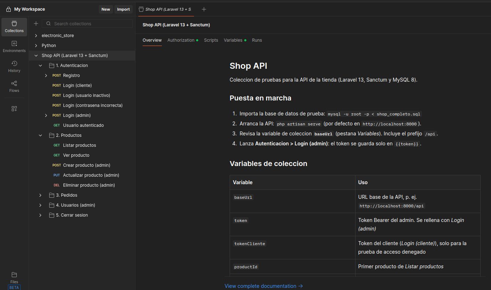
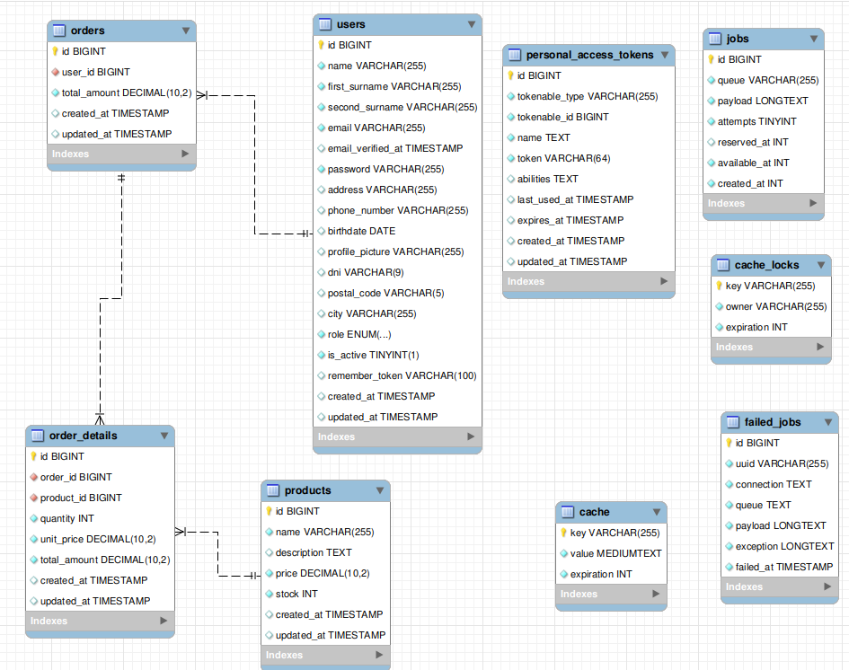

# Basic App Laravel 13 Sanctum (Backend)

📘 Also available in [Spanish](./README.es.md)

> **Update:** the application has been updated to Laravel 13 (requires PHP 8.3 or higher). The previous Laravel 12 version is still available on the [`main`](https://github.com/nuriadevs/basic-app-laravel-12-sanctum-backend/tree/main) branch.

This application was developed with Laravel. It provides CRUD operations and a basic authentication and registration system.

## Environment 🛠️

- PHP 8.3 or higher

- [Laravel 13](https://laravel.com/docs/13.x)

- [Laravel Sanctum](https://laravel.com/docs/13.x/sanctum#main-content)

- API

- Tests

- CRUD

- MySQL

- Postman or Bruno

- Visual Studio Code

## Installation ⚙️

1. Clone the Laravel 13 branch to your local machine: `git clone -b upgrade-laravel-13 https://github.com/nuriadevs/basic-app-laravel-12-sanctum-backend`.

2. Install the PHP dependencies with `composer install`.

3. Copy the `.env.example` file to `.env` with `cp .env.example .env`.

4. Generate an application key with `php artisan key:generate`.

5. Configure your database in the `.env` file (`DB_DATABASE=shop`, username and password) and set `SESSION_DRIVER=file`.

6. Create the database and the test data by importing the SQL script (do not use `php artisan migrate`):

    `mysql -u root -p < database/shop_completo.sql`

7. Start the development server with `php artisan serve`.

8. Open the application in your web browser at [http://localhost:8000](http://localhost:8000).

> ⚠️ The script runs `DROP DATABASE IF EXISTS shop`, so it deletes any existing `shop` database.

### Test users

| Role     | Email                                                                                         | Password      |
| -------- | --------------------------------------------------------------------------------------------- | ------------- |
| Admin    | laura@example.com                                                                             | Admin1234!    |
| Customer | carlos@example.com, ana@example.com, david@example.com, javier@example.com, lucia@example.com | Customer1234! |
| Inactive | marta@example.com                                                                             | Customer1234! |

## API Endpoints

| Endpoint           | **Methods** | Routes                 |
| ------------------ | ----------- | ---------------------- |
| **Authentication** |             |                        |
| Login              | POST        | api/auth/login         |
| Register           | POST        | api/auth/register      |
| Logout             | POST        | api/auth/logout        |
| Authenticated user | GET         | api/user               |
| **Users**          |             |                        |
| Index              | GET         | api/users              |
| Show               | GET         | api/users/{user}       |
| Store              | POST        | api/users              |
| Update             | PATCH       | api/users/{user}       |
| Destroy            | DELETE      | api/users/{user}       |
| **Products**       |             |                        |
| Index              | GET         | api/products           |
| Show               | GET         | api/products/{product} |
| Store              | POST        | api/products           |
| Update             | PATCH       | api/products/{product} |
| Destroy            | DELETE      | api/products/{product} |
| **Orders**         |             |                        |
| Index              | GET         | api/orders             |
| Show               | GET         | api/orders/{order}     |
| Store              | POST        | api/orders             |
| Update             | PATCH       | api/orders/{order}     |
| Destroy            | DELETE      | api/orders/{order}     |

## Environment Variables

Check `.env.example` to create your environment.

## Postman Demo :man_astronaut:

## Database Schema

## Links

- [Laravel](https://laravel.com/docs/13.x/releases)
- [Bruno](https://www.usebruno.com/)
- [Postman](https://www.postman.com/)
- [PHP](https://www.php.net/)

## Summary

- Don't forget to create your own `.env` file for the variables.
- The data used in the API is entirely fictitious and is used for testing purposes.
- The test data is loaded with the `shop_completo.sql` script.
- The `email_verified_at` column is ready, but email verification is not implemented yet.
- This project is under construction... it can be improved.

## Thank you 🍀

Thank you very much for reading this project.
